<p align="center"></p>

<p align="center">
  <b>Os cursos que você já tem no computador, organizados como numa plataforma de streaming.</b><br>
  Módulos, progresso salvo, notas no momento exato da aula e o PDF de apoio ao lado do vídeo.
</p>

<p align="center">
  <a href="https://github.com/gabrielsoares97/cursoflix-updates/releases/latest"></a>
  
  
  <a href="LICENSE"></a>
  <a href="https://wa.me/5547992201382?text=Quero%20assinar%20o%20Cursoflix"></a>
</p>

<p align="center">
  <a href="https://github.com/gabrielsoares97/cursoflix-updates/releases/latest"><b>Baixar para Windows</b></a> ·
  <a href="#como-usar">Como usar</a> ·
  <a href="#atalhos-do-teclado">Atalhos</a> ·
  <a href="#criar-um-tema">Criar um tema</a> ·
  <a href="#perguntas-frequentes">Perguntas frequentes</a>
</p>

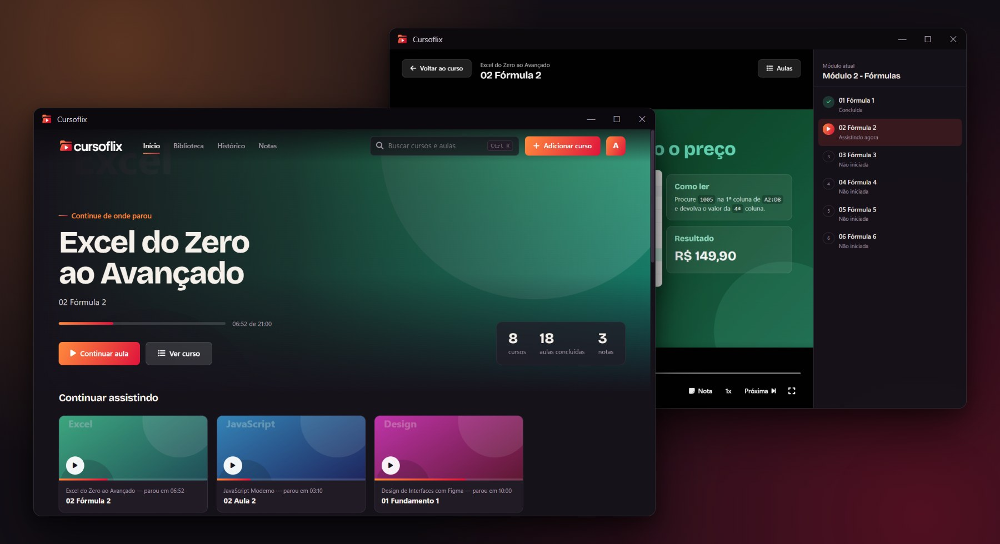

> [!IMPORTANT]
> **O Cursoflix funciona com assinatura.** Para usar o app (e qualquer personalização deste repositório) você precisa do app oficial e de uma assinatura ativa. Quer assinar ou renovar? [Fale no WhatsApp](https://wa.me/5547992201382?text=Quero%20assinar%20o%20Cursoflix).

## Sumário

- [O que é o Cursoflix](#o-que-é-o-cursoflix)
- [Recursos](#recursos)
- [Instalação](#instalação)
- [Como usar](#como-usar)
  - [Entrar na conta](#1-entrar-na-conta)
  - [Adicionar cursos](#2-adicionar-cursos)
  - [Como organizar as pastas](#como-organizar-as-pastas)
  - [Tela inicial](#3-tela-inicial)
  - [Biblioteca](#4-biblioteca)
  - [Página do curso](#5-página-do-curso)
  - [Player](#6-player)
  - [PDF ao lado da aula](#7-pdf-ao-lado-da-aula)
  - [Notas](#8-notas)
  - [Busca](#9-busca)
  - [Histórico](#10-histórico)
  - [Menu da conta](#11-menu-da-conta)
  - [Aparência e temas](#12-aparência-e-temas)
  - [Atualizações](#13-atualizações)
  - [Assinatura vencida](#14-assinatura-vencida)
- [Atalhos do teclado](#atalhos-do-teclado)
- [Formatos aceitos](#formatos-aceitos)
- [Criar um tema](#criar-um-tema)
- [Ferramentas usadas](#ferramentas-usadas)
- [O que tem neste repositório](#o-que-tem-neste-repositório)
- [Perguntas frequentes](#perguntas-frequentes)
- [Suporte](#suporte)
- [Licença](#licença)

## O que é o Cursoflix

O Cursoflix é um app de desktop para Windows. Você aponta as pastas dos cursos que já baixou e ele monta uma biblioteca com capas, módulos e aulas em ordem, lembra onde você parou e deixa o material em PDF aberto ao lado do vídeo.

Ele **não baixa nem vende cursos**: só organiza e reproduz os arquivos que já estão no seu computador. Os vídeos não saem da sua máquina; a internet é usada para entrar na conta, conferir a assinatura e baixar atualizações do app.

Este repositório tem duas coisas:

- o **instalador oficial**, em [Releases](https://github.com/gabrielsoares97/cursoflix-updates/releases/latest), de onde o app também se atualiza sozinho;
- o código da **parte visual** (interface e temas), para quem quer deixar o Cursoflix com a sua cara. A lógica do app (assinatura, leitura das pastas e reprodução dos arquivos) não está aqui.

## Recursos

| | |
| --- | --- |
| **Biblioteca automática** | Escolha a pasta do curso e o app encontra módulos, aulas, PDFs e a capa. Ordem natural: Aula 2 vem antes de Aula 10. |
| **Continue de onde parou** | A tela inicial abre na última aula, no segundo exato em que você parou. |
| **Player completo** | Atalhos de teclado, tela cheia, ±10 s, velocidade de 0,5× a 2×, volume e velocidade lembrados, próxima aula automática. |
| **PDF ao lado do vídeo** | O PDF com o mesmo nome da aula abre ao lado do player. PDFs soltos no módulo viram material de apoio. |
| **Notas com tempo** | Aperte <kbd>N</kbd> para anotar um momento da aula. A nota aparece na linha do tempo e leva de volta àquele ponto. |
| **Busca rápida** | <kbd>Ctrl</kbd> + <kbd>K</kbd> procura cursos e aulas de toda a biblioteca. |
| **Histórico** | Todas as aulas que você abriu, agrupadas por dia. |
| **Temas** | Brasa, Oceano e Claro, ou um tema criado por você. |
| **Funciona sem internet** | Depois de entrar, o app funciona até 7 dias offline. |
| **Vídeos difíceis** | Formatos sem suporte direto (MKV, AVI, WMV…) são convertidos na hora, sem criar cópias. |
| **Atualiza sozinho** | Quando sai uma versão nova, o app avisa e instala com um clique. |

## Instalação

1. Baixe o instalador mais recente em [Releases](https://github.com/gabrielsoares97/cursoflix-updates/releases/latest): o arquivo é `Cursoflix-Setup-<versão>-x64.exe`.
2. Abra o arquivo. O instalador não tem assinatura digital, então o Windows pode mostrar **"O Windows protegeu o computador"** ou "editor desconhecido". Clique em **Mais informações → Executar assim mesmo**.
3. Escolha a pasta de instalação (ou deixe a sugerida) e conclua. O atalho aparece na área de trabalho.
4. Abra o Cursoflix e entre com o e-mail e a senha da sua assinatura.

**Requisitos**

| | |
| --- | --- |
| Sistema | Windows 10 ou 11, 64 bits |
| Espaço | cerca de 450 MB para o app (os cursos ficam onde você já guarda) |
| Internet | para entrar na conta e receber atualizações; depois funciona até 7 dias offline |
| Conta | assinatura ativa do Cursoflix |

## Como usar

### 1. Entrar na conta

Use o e-mail e a senha da sua assinatura. A sessão se renova sozinha, então você não precisa entrar de novo toda vez que abrir o app. Ainda não assina? O botão **Assinar pelo WhatsApp** abre a conversa direto.

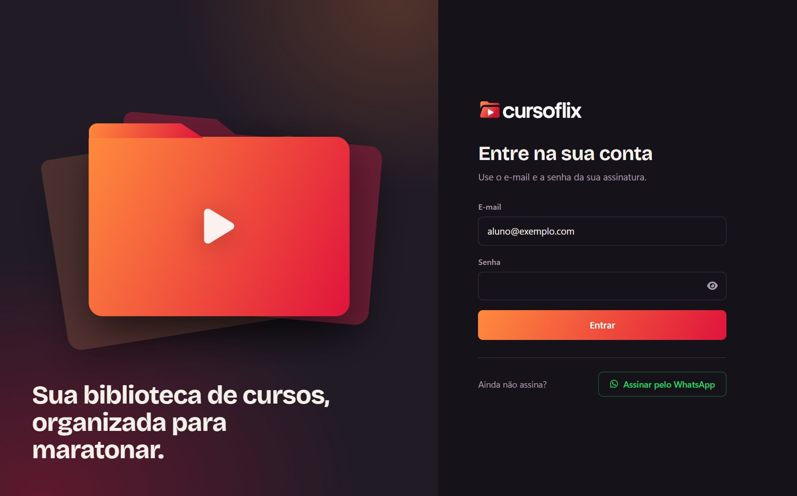

### 2. Adicionar cursos

Na primeira vez a biblioteca está vazia. Clique em **Escolher pasta do curso** (ou em **Adicionar curso**, no topo) e selecione a pasta de um ou mais cursos. Para cada pasta você confirma o nome, escolhe uma **categoria** e, se quiser, uma **capa**.

<table>
  <tr>
    <td>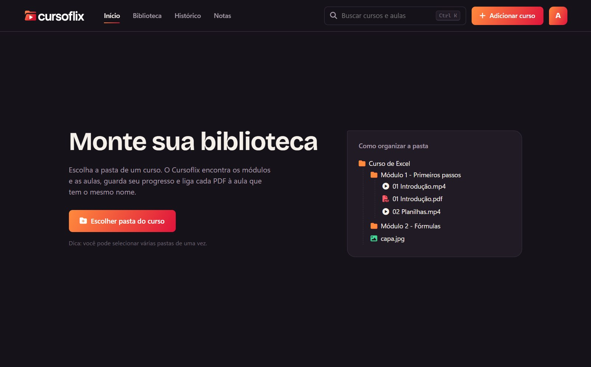</td>
    <td>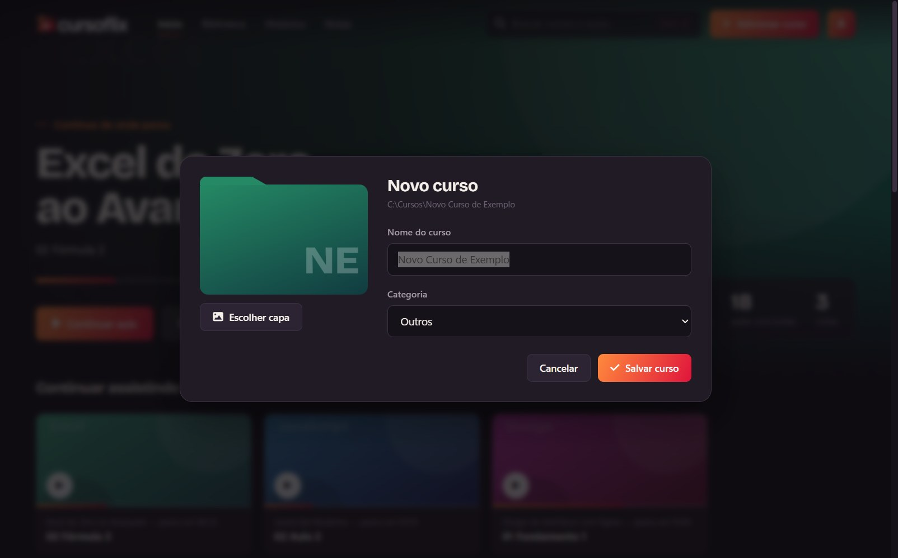</td>
  </tr>
  <tr>
    <td align="center">Biblioteca vazia, com o exemplo de organização</td>
    <td align="center">Nome, categoria e capa do curso</td>
  </tr>
</table>

> [!TIP]
> Dá para selecionar várias pastas de uma vez. O app abre uma janela de confirmação para cada curso.

#### Como organizar as pastas

O Cursoflix lê a pasta do jeito que ela está; não precisa renomear nada. Quanto mais organizada, melhor fica a biblioteca:

```text
Excel do Zero ao Avançado/          ← a pasta que você escolhe no app
├── capa.jpg                        ← vira a capa do curso
├── Módulo 1 - Primeiros passos/    ← cada pasta com vídeos vira um módulo
│   ├── 01 Boas-vindas.mp4
│   ├── 01 Boas-vindas.pdf          ← mesmo nome do vídeo: abre ao lado desta aula
│   ├── 02 Conhecendo a interface.mp4
│   └── Apostila do módulo.pdf      ← PDF solto: material de apoio do módulo
└── Módulo 2 - Fórmulas/
    ├── 01 Fórmula 1.mp4
    ├── 02 Fórmula 2.mp4
    └── ...
```

| Na pasta | No app |
| --- | --- |
| Uma subpasta com vídeos | Um módulo. Subpastas dentro de subpastas viram "Módulo 1 / Parte A". |
| Vídeos soltos na pasta principal | Um módulo chamado **Geral**. |
| PDF com o **mesmo nome** do vídeo | Material da aula, aberto ao lado do player (tecla <kbd>P</kbd>). |
| Outros PDFs dentro do módulo | Materiais de apoio do módulo, na página do curso. |
| `capa`, `cover`, `folder` ou `poster` (`.jpg`, `.jpeg`, `.png`, `.webp`) na pasta principal | Capa automática. Sem imagem, o app gera uma capa colorida com as iniciais. |
| Números no começo dos nomes | Ordem natural: `2` vem antes de `10`, sem precisar de `02`. |

Pastas de sistema (`$RECYCLE.BIN`, `System Volume Information`, `__MACOSX`) são ignoradas, e o app lê até 10 níveis de subpastas.

### 3. Tela inicial

O destaque mostra a última aula que você assistiu, com a barra de progresso e o botão **Continuar aula**. Ao lado ficam os números da sua biblioteca (cursos, aulas concluídas e notas). Logo abaixo vem a fileira **Continuar assistindo** e uma fileira para cada categoria.

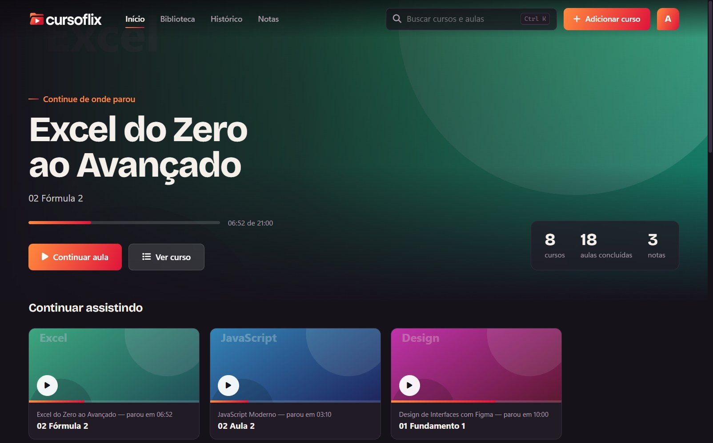

### 4. Biblioteca

Todos os cursos num só lugar, com o progresso de cada um. Ordene por **Recentes**, **A–Z** ou **Progresso**. Cursos terminados ganham o selo **Concluído**.

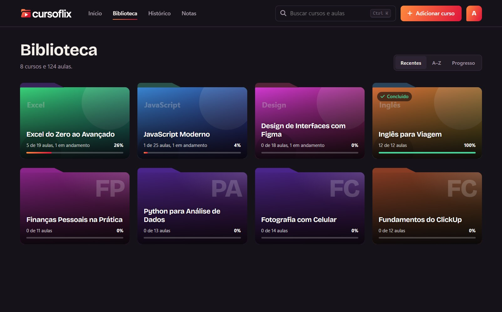

Clique com o botão direito em um curso para **continuar**, **editar nome, categoria e capa**, **marcar como concluído**, **zerar o progresso** ou **remover da biblioteca**. Remover não apaga nada do computador: se você adicionar a pasta de novo, o progresso volta.

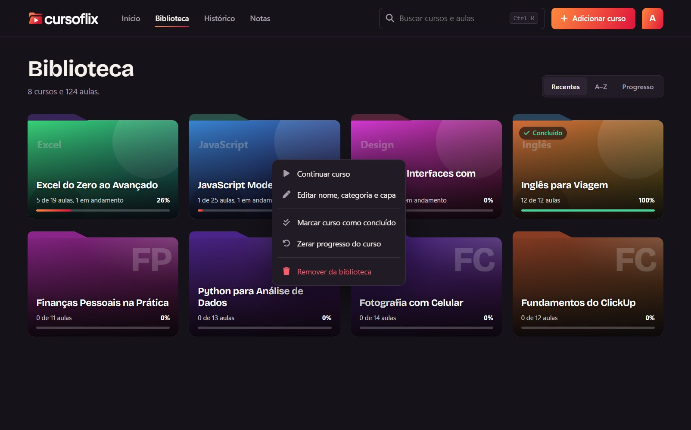

### 5. Página do curso

Mostra quantos módulos, aulas e materiais o curso tem, o quanto você já concluiu e o botão para continuar na aula certa. Cada módulo abre e fecha e mostra o status de cada aula: concluída, onde você parou ou não iniciada.

Clique com o botão direito em uma aula para **assistir**, **abrir o material** ou **marcar como concluída / não assistida**.

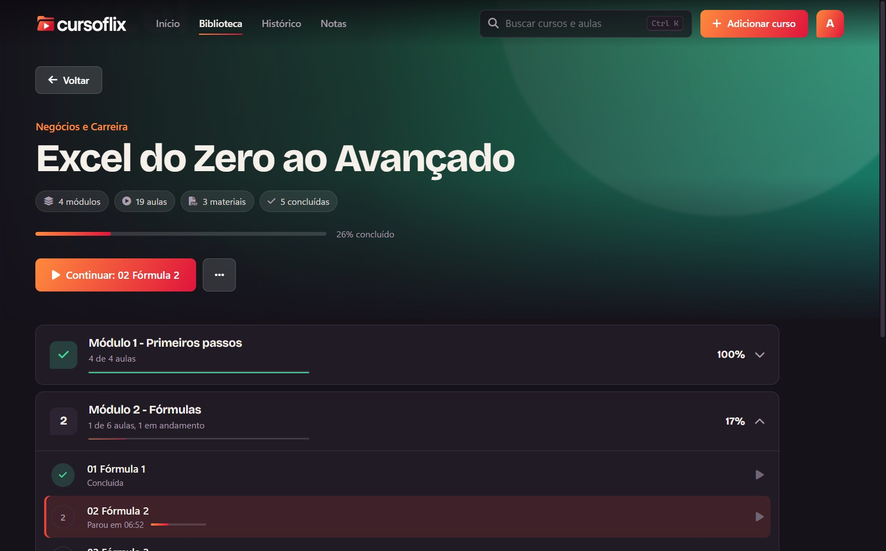

### 6. Player

- Linha do tempo com o trecho já carregado e marcadores das suas notas.
- Voltar e avançar 10 segundos, volume, velocidade de 0,5× a 2× e tela cheia.
- Painel **Aulas** com as aulas do módulo atual (pode ser escondido).
- **Próxima** pula para a aula seguinte. No fim de uma aula, a próxima começa sozinha em 8 segundos, e dá para cancelar.
- O progresso é salvo enquanto você assiste, inclusive se fechar o player no meio.

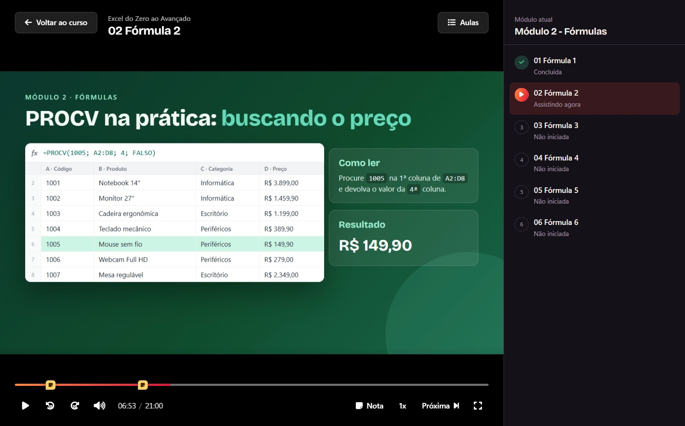

### 7. PDF ao lado da aula

Quando a aula tem um PDF com o mesmo nome, o botão de PDF (ou a tecla <kbd>P</kbd>) abre o material ao lado do vídeo, com zoom e busca no texto.

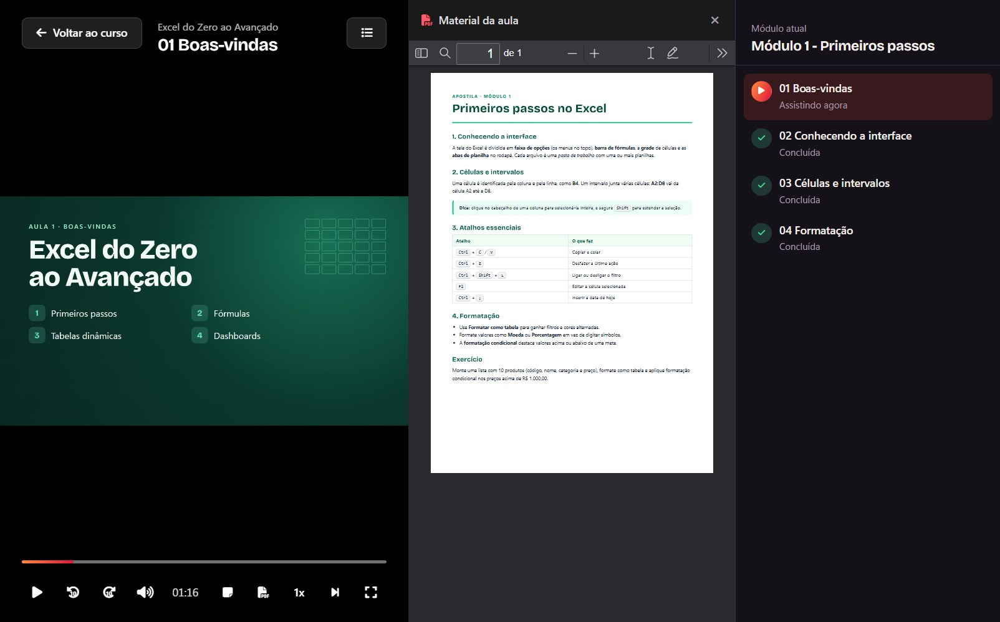

### 8. Notas

No player, aperte <kbd>N</kbd> (ou o botão **Nota**) para anotar algo no momento atual da aula. <kbd>Ctrl</kbd> + <kbd>Enter</kbd> salva.

Na aba **Notas** elas ficam agrupadas por curso. Clique em uma nota para voltar exatamente àquele ponto da aula, filtre por texto, edite, exclua ou use **Copiar todas** para levar suas anotações para outro lugar.

<table>
  <tr>
    <td>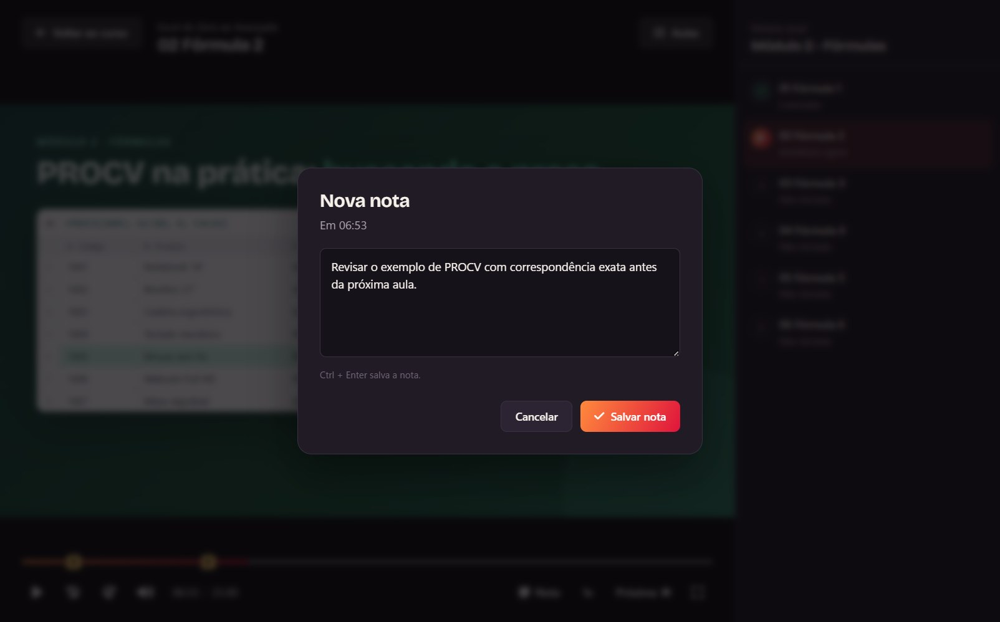</td>
    <td>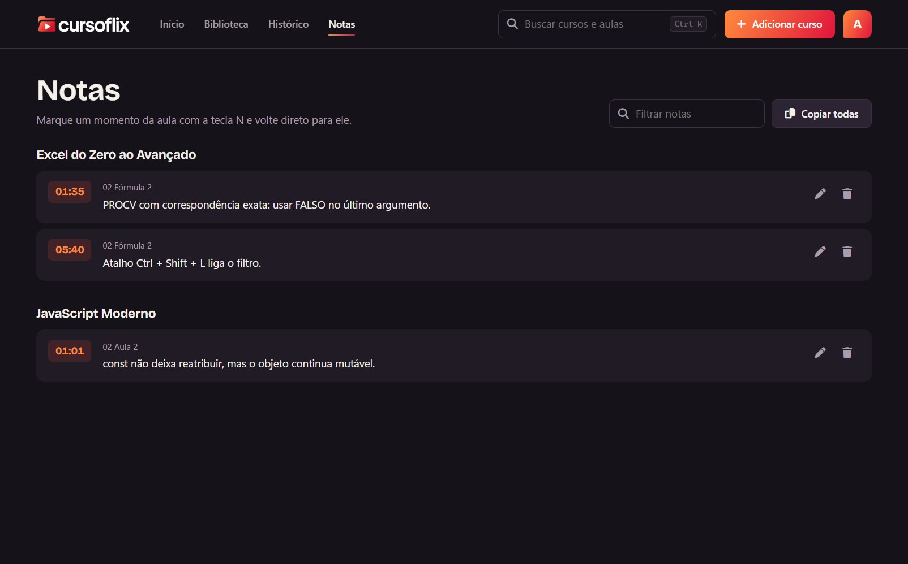</td>
  </tr>
  <tr>
    <td align="center">Nova nota durante a aula</td>
    <td align="center">Notas agrupadas por curso</td>
  </tr>
</table>

### 9. Busca

<kbd>Ctrl</kbd> + <kbd>K</kbd> (ou o campo no topo) procura cursos e aulas na biblioteca inteira, sem diferenciar acentos. Cada resultado mostra o status da aula; clique para ir direto a ela.

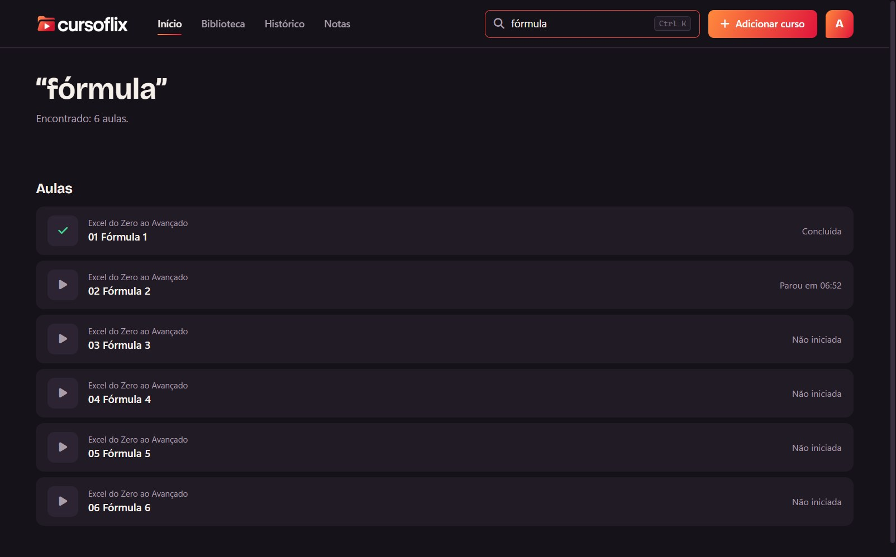

### 10. Histórico

As aulas que você abriu, da mais recente para a mais antiga, agrupadas por dia (Hoje, Ontem…). Mostra onde você parou em cada uma e a hora.

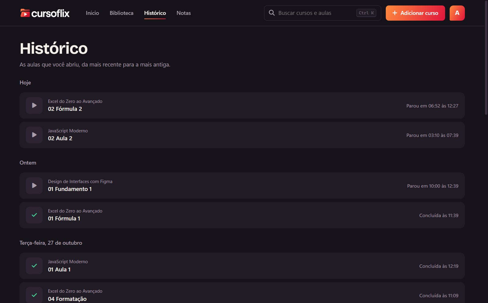

### 11. Menu da conta

O botão com a sua inicial, no canto superior direito, mostra o e-mail e até quando vai a assinatura. Dali você renova a assinatura, troca o tema, vê os atalhos e as novidades da versão, fala com o suporte e sai da conta.

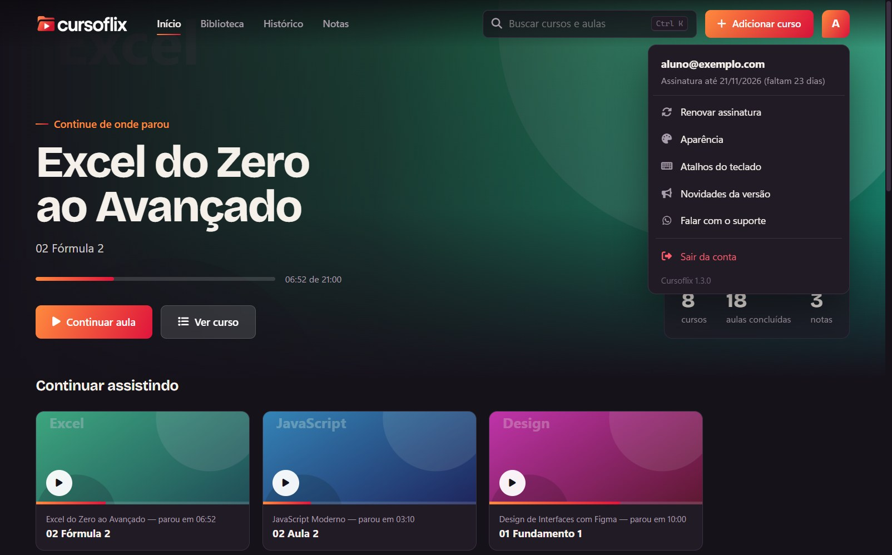

### 12. Aparência e temas

Em **menu da conta → Aparência** você troca o tema na hora. Vêm três prontos, e você pode **importar** um tema próprio (veja [Criar um tema](#criar-um-tema)).

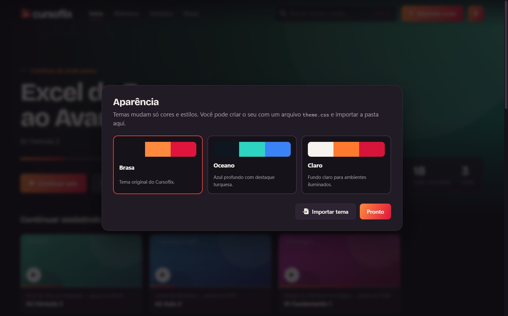

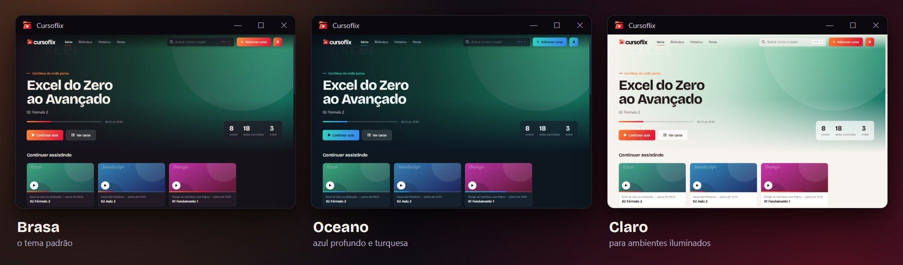

### 13. Atualizações

Quando sai uma versão nova, aparece um aviso no canto da tela. **Baixar e instalar** faz o resto; seus cursos, progresso e notas continuam onde estavam.

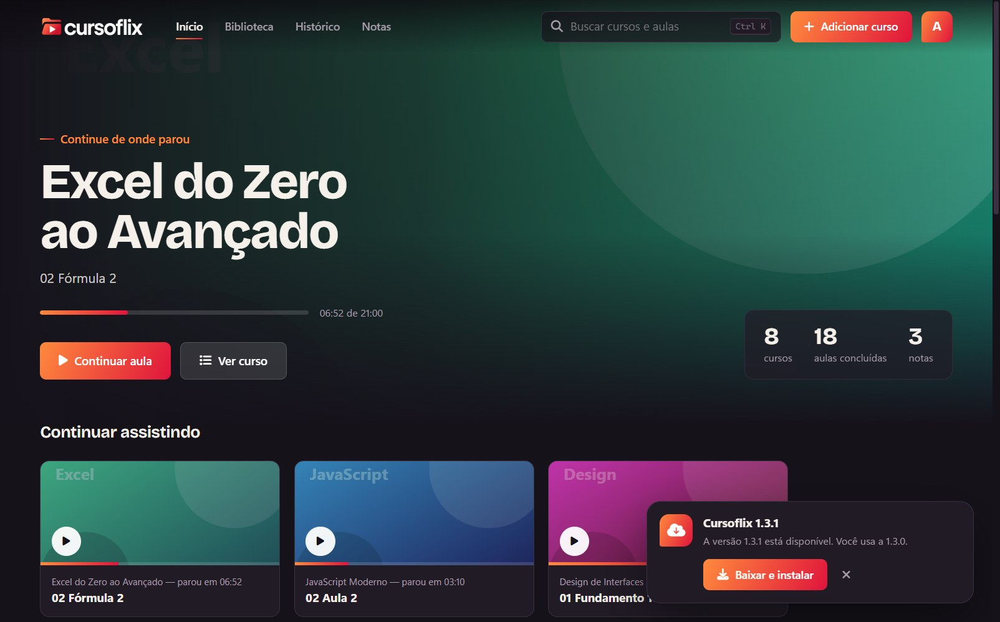

### 14. Assinatura vencida

Se a assinatura vencer, o app mostra uma tela clara com **Renovar pelo WhatsApp**. Depois de renovar, clique em **Já renovei, verificar de novo** e continue de onde parou: progresso e notas ficam salvos.

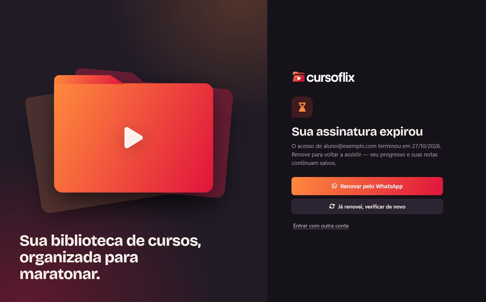

## Atalhos do teclado

| Atalho | O que faz |
| --- | --- |
| <kbd>Espaço</kbd> ou <kbd>K</kbd> | Reproduzir ou pausar |
| <kbd>←</kbd> / <kbd>→</kbd> | Voltar ou avançar 10 segundos |
| <kbd>↑</kbd> / <kbd>↓</kbd> | Aumentar ou diminuir o volume |
| <kbd>M</kbd> | Ativar ou desativar o som |
| <kbd>F</kbd> | Tela cheia |
| <kbd>N</kbd> | Criar nota no momento atual |
| <kbd>P</kbd> | Abrir ou fechar o material da aula |
| <kbd>Shift</kbd> + <kbd>N</kbd> | Próxima aula |
| <kbd>Shift</kbd> + <kbd><</kbd> / <kbd>></kbd> | Diminuir ou aumentar a velocidade |
| <kbd>Esc</kbd> | Sair da tela cheia ou voltar ao curso |
| <kbd>Ctrl</kbd> + <kbd>K</kbd> | Buscar cursos e aulas |

A lista também fica no app, em **menu da conta → Atalhos do teclado**.

<details>
<summary>Ver a janela de atalhos</summary>

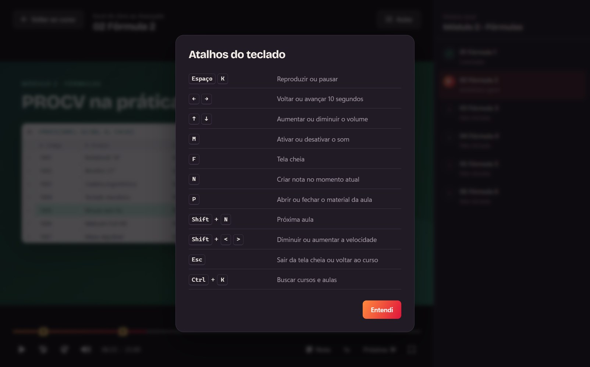

</details>

## Formatos aceitos

| Tipo | Extensões |
| --- | --- |
| Vídeo, reprodução direta | `.mp4` `.webm` `.ogv` |
| Vídeo, convertido na hora | `.mkv` `.avi` `.mov` `.m4v` `.wmv` `.flv` `.ts` `.m2ts` `.mpg` `.mpeg` `.3gp` |
| Material | `.pdf` |
| Capa | `.jpg` `.jpeg` `.png` `.webp` |

Um MP4 com um codec que o player não reproduz também é convertido automaticamente.

## Criar um tema

Um tema muda só a aparência: cores, fontes, bordas. É uma pasta com um `theme.css` (obrigatório) e um `theme.json` (opcional).

```text
meu-tema/
├── theme.css    as cores e estilos
└── theme.json   nome, autor e cores da miniatura
```

### 1. Ver a interface no navegador

Precisa do [Node.js](https://nodejs.org) 18 ou mais novo. Não tem dependências para instalar.

```bash
git clone https://github.com/gabrielsoares97/cursoflix-updates.git
```

```bash
cd cursoflix-updates
```

```bash
npm run preview
```

Abra http://localhost:4317. A interface carrega cursos de exemplo ([dev/mock-api.js](dev/mock-api.js)), então dá para navegar, abrir o player e testar seu tema sem o app.

| Endereço | O que mostra |
| --- | --- |
| http://localhost:4317 | Início com cursos de exemplo |
| http://localhost:4317/?estado=login | Tela de login (senha de teste: `demo`) |
| http://localhost:4317/?estado=expirado | Assinatura vencida |
| http://localhost:4317/?estado=vazio | Biblioteca vazia |
| http://localhost:4317/?atualizacao | Aviso de nova versão |

### 2. Trocar as cores

O jeito mais rápido é copiar [themes/oceano](themes/oceano) e mudar as variáveis. Este é o tema Oceano inteiro:

```css
:root {
  --cf-bg: #0e1720;          /* fundo do app */
  --cf-surface: #15222e;     /* cartões, painéis e modais */
  --cf-raised: #1d2f3e;      /* destaque e efeito ao passar o mouse */
  --cf-line: #29404f;        /* bordas e divisórias */
  --cf-text: #eef6f8;        /* texto principal */
  --cf-muted: #93aab6;       /* texto secundário */
  --cf-accent-a: #2dd4bf;    /* gradiente de destaque, cor 1 */
  --cf-accent-b: #3b82f6;    /* gradiente de destaque, cor 2 */
  --cf-accent: #22b8c9;      /* destaque sólido */
  --cf-on-accent: #04141c;   /* texto em cima do destaque */
}
```

Para testar na pré-visualização, coloque a pasta do tema em `themes/` e acrescente-o à lista `themes` em [dev/mock-api.js](dev/mock-api.js). A lista completa de variáveis, o `theme.json` e os limites estão em [docs/TEMAS.md](docs/TEMAS.md).

### 3. Importar no app

**Menu da conta → Aparência → Importar tema** e escolha a pasta. O tema fica salvo no app e pode ser trocado quando quiser.

> [!NOTE]
> Por segurança, o app não executa JavaScript de temas e bloqueia `@import` e imagens externas. Um tema não consegue enviar dados para fora nem mexer na sua conta. Imagens só funcionam embutidas como `data:` e o `theme.css` pode ter até 512 KB.

Quer mexer além das cores? Veja [themes/claro/theme.css](themes/claro/theme.css), que muda o cabeçalho e o logo, e use o inspetor do navegador na pré-visualização para descobrir as classes. O que a interface pode pedir ao app está em [docs/API.md](docs/API.md).

## Ferramentas usadas

| Ferramenta | Para quê |
| --- | --- |
| [Electron](https://www.electronjs.org) | O app de desktop (Chromium + Node.js) |
| HTML, CSS e JavaScript puros | A interface, sem framework e sem etapa de build |
| [FFmpeg](https://ffmpeg.org) | Conversão na hora dos vídeos que o player não reproduz direto |
| [PDF.js](https://mozilla.github.io/pdf.js/) | Leitor dos PDFs ao lado da aula |
| [electron-builder](https://www.electron.build) + NSIS | Instalador para Windows |
| [electron-updater](https://www.electron.build/auto-update) + GitHub Releases | Atualização automática |
| [Font Awesome Free](https://fontawesome.com) | Ícones |
| [Bricolage Grotesque](https://fonts.google.com/specimen/Bricolage+Grotesque) | Fonte dos títulos |
| [Node.js](https://nodejs.org) | Servidor da pré-visualização (`npm run preview`) |

## O que tem neste repositório

```text
index.html, style.css, renderer.js   a interface do app
themes/                              temas de exemplo (Oceano e Claro)
dev/                                 pré-visualização com dados de exemplo
docs/TEMAS.md                        como criar temas
docs/API.md                          o que a interface pode pedir ao app
docs/prints/                         as imagens deste README
img/                                 logo e ícones
vendor/                              ícones (Font Awesome Free) e fonte (Bricolage Grotesque)
```

Os instaladores ficam em [Releases](https://github.com/gabrielsoares97/cursoflix-updates/releases), não no código.

## Perguntas frequentes

<details>
<summary><b>O Cursoflix vem com cursos?</b></summary>

Não. Ele organiza e reproduz os cursos que você já tem no computador ou num HD externo.
</details>

<details>
<summary><b>Meus vídeos são enviados para algum lugar?</b></summary>

Não. Os arquivos ficam no seu computador e são reproduzidos localmente. A internet é usada só para entrar na conta, conferir a assinatura e baixar atualizações do app.
</details>

<details>
<summary><b>Funciona sem internet?</b></summary>

Sim, por até 7 dias depois da última verificação da assinatura. Quando a internet voltar, o app confere a assinatura de novo sozinho.
</details>

<details>
<summary><b>O Windows disse que o app pode ser perigoso. É normal?</b></summary>

Sim. O instalador não tem assinatura digital paga, e o Windows avisa sobre qualquer programa nessa situação. Baixe sempre pelo link de [Releases](https://github.com/gabrielsoares97/cursoflix-updates/releases/latest) e clique em **Mais informações → Executar assim mesmo**.
</details>

<details>
<summary><b>Meus cursos estão num HD externo. E se ele estiver desconectado?</b></summary>

O app avisa que não encontrou a pasta do curso, mas não apaga o curso nem o progresso. Ao reconectar o HD, tudo volta.
</details>

<details>
<summary><b>O PDF não aparece ao lado da aula.</b></summary>

O PDF precisa ter exatamente o mesmo nome do vídeo (só a extensão muda), na mesma pasta: `01 Boas-vindas.mp4` e `01 Boas-vindas.pdf`. PDFs com outro nome aparecem como material de apoio do módulo, na página do curso.
</details>

<details>
<summary><b>As aulas aparecem fora de ordem.</b></summary>

O app ordena pelo nome do arquivo, em ordem natural. Comece os nomes com o número da aula (`1 Introdução`, `2 Planilhas`, …). O app lê a pasta de novo toda vez que abre, então basta reabrir. Só as aulas renomeadas perdem o progresso salvo, porque o app as vê como arquivos novos.
</details>

<details>
<summary><b>Um vídeo não toca.</b></summary>

Formatos como MKV e AVI, e MP4 com codec sem suporte, são convertidos automaticamente; o primeiro carregamento pode levar alguns segundos. Se mesmo assim não tocar, [fale com o suporte](https://wa.me/5547992201382).
</details>

<details>
<summary><b>Removi um curso sem querer. Perdi o progresso?</b></summary>

Não. Remover só tira o curso da biblioteca; os arquivos continuam no computador. Adicione a mesma pasta de novo e o progresso volta.
</details>

<details>
<summary><b>Tem versão para Mac ou Linux?</b></summary>

Por enquanto, só Windows.
</details>

## Suporte

Dúvidas, problemas ou renovação: [WhatsApp](https://wa.me/5547992201382). No app, o atalho fica em **menu da conta → Falar com o suporte**.

## Licença

Código-fonte disponível, **não** é código aberto. Você pode fazer fork, personalizar a aparência e compartilhar temas gratuitamente, sempre para uso com o app oficial e uma assinatura ativa. É proibido contornar a assinatura, criar um app ou servidor substituto, redistribuir comercialmente e fazer engenharia reversa. Detalhes em [LICENSE](LICENSE).

**Inteligência artificial:** é proibido usar este repositório para treinar ou alimentar modelos de IA, ou usar IA para reproduzir ou contornar o Cursoflix. Veja [AI-NOTICE.md](AI-NOTICE.md).

Componentes de terceiros em `vendor/` mantêm as próprias licenças (Font Awesome Free: CC BY 4.0, SIL OFL 1.1 e MIT; Bricolage Grotesque: SIL OFL 1.1).

As imagens deste README usam cursos, aulas e materiais fictícios, criados só para demonstração.

© 2026 Gabriel. Todos os direitos reservados.
