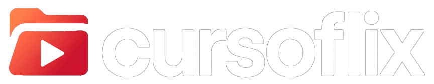

<p align="center"></p>

# Cursoflix — interface e temas

O Cursoflix é um app de desktop para assistir aos cursos que você já tem no computador como se fosse uma plataforma de streaming: módulos organizados, progresso salvo, notas no momento exato da aula e o PDF de apoio ao lado do vídeo.

Este repositório tem o instalador oficial do app (em **Releases**) e o código da **parte visual**, para você deixar o Cursoflix com a sua cara: cores, temas e estilos. A lógica do app (assinatura, leitura das pastas e reprodução dos arquivos) não está aqui.

> **Para usar qualquer personalização você precisa do app oficial e de uma assinatura ativa.** Quer assinar? [Fale no WhatsApp](https://wa.me/5547992201382?text=Quero%20assinar%20o%20Cursoflix).

## Baixar o app

O instalador para Windows está em [Releases](https://github.com/gabrielsoares97/cursoflix-updates/releases/latest) (`Cursoflix-Setup-<versão>-x64.exe`). Depois de instalado, o app se atualiza sozinho a partir daqui.

O instalador não tem assinatura digital, então o Windows pode mostrar "editor desconhecido". Clique em **Mais informações → Executar assim mesmo**.

## Ver a interface no navegador

Precisa do [Node.js](https://nodejs.org) 18 ou mais novo. Não tem dependências para instalar.

```bash
npm run preview
```

Abra http://localhost:4317. A interface carrega cursos de exemplo (`dev/mock-api.js`), então dá para navegar, abrir o player e testar seu tema sem o app.

| Endereço | O que mostra |
| --- | --- |
| http://localhost:4317 | Início com cursos de exemplo |
| http://localhost:4317/?estado=login | Tela de login (senha de teste: `demo`) |
| http://localhost:4317/?estado=expirado | Assinatura vencida |
| http://localhost:4317/?estado=vazio | Biblioteca vazia |

## Criar um tema

Um tema é uma pasta com `theme.css` (e, se quiser, `theme.json`). O jeito mais rápido é copiar `themes/oceano` e trocar as cores.

O guia completo, com todas as variáveis, está em [docs/TEMAS.md](docs/TEMAS.md).

No app: menu da conta → **Aparência** → **Importar tema** → escolha a pasta do tema.

## O que tem aqui

```
index.html, style.css, renderer.js   a interface do app
themes/                              temas de exemplo (Oceano e Claro)
dev/                                 pré-visualização com dados de exemplo
docs/TEMAS.md                        como criar temas
docs/API.md                          o que a interface pode pedir ao app
vendor/                              ícones (Font Awesome Free) e fonte (Bricolage Grotesque)
```

## Licença

Código-fonte disponível, **não** é código aberto. Você pode fazer fork, personalizar a aparência e compartilhar temas gratuitamente, sempre para uso com o app oficial e uma assinatura ativa. É proibido contornar a assinatura, criar um app ou servidor substituto, redistribuir comercialmente e fazer engenharia reversa. Detalhes em [LICENSE](LICENSE).

**Inteligência artificial:** é proibido usar este repositório para treinar ou alimentar modelos de IA, ou usar IA para reproduzir ou contornar o Cursoflix. Veja [AI-NOTICE.md](AI-NOTICE.md).

Componentes de terceiros em `vendor/` mantêm as próprias licenças (Font Awesome Free: CC BY 4.0, SIL OFL 1.1 e MIT; Bricolage Grotesque: SIL OFL 1.1).

© 2026 Gabriel. Todos os direitos reservados.
